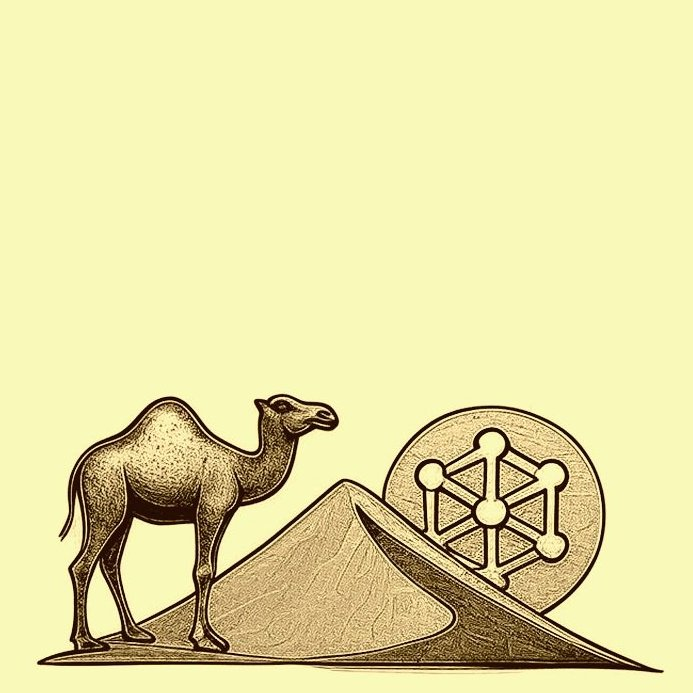

```
▖  ▖▄▖▄▖▄▖▄▖▄▖▖ ▄▖▖  ▖
▛▖▞▌▌▌▌ ▙▘▌▌▚ ▌ ▌▌▌▞▖▌
▌▝ ▌▛▌▙▖▌▌▙▌▄▌▙▖▙▌▛ ▝▌
                      
```


by webXOS 2026

https://grokipedia.com/page/Macroslow

Macroslow 🐪 is an open-source, educational repository hosted on GitHub, launched in 2025, that provides guides, tutorials, and templates for constructing qubit-based quantum computing systems secured by the 2048-AES protocol. Developed by the WebXOS team, it emphasizes quantum-ready software development, including integrations with quantum frameworks such as Qiskit and QuTiP for quantum simulations, PyTorch for machine learning applications, and SQLAlchemy for database management. Key features of Macroslow include hardware guides for systems like NVIDIA Jetson Orin and Intel ecosystems, multi-stage Docker deployments for scalable setups, and specialized agents for tasks ranging from Markdown processing to quantum-enhanced machine learning. It also introduces the MAML (Markdown as Medium Language) protocol for encoding multimodal security data with executable workflows, alongside support for Kubernetes/Helm orchestration and Prometheus monitoring to facilitate distributed infrastructure for peer-to-peer interactions and token-based incentives in applications like decentralized exchanges (DEXs) and DePIN frameworks. 

# History and Development

Macroslow was initiated by the WebXOS team in 2025 as an open-source, AI-orchestrated educational repository designed to provide guides, tutorials, and templates for building qubit-based quantum computing systems secured by the 2048-AES protocol, aiming to democratize access to quantum education. The project emerged from the WebXOS organization's focus on innovative software development, particularly in decentralized and quantum-ready applications, with the repository's copyright held by WebXOS since 2025.

Development began with initial commits on August 23, 2025, marking the start of foundational infrastructure guides and setup instructions, including the creation of Dockerfiles such as Dockerfile.alchemist, Dockerfile.final, Dockerfile.full, and Dockerfile.monitor to support scalable deployments for quantum simulations and AI integrations. This early phase emphasized AI orchestration, integrating tools like PyTorch for machine learning-enhanced quantum workflows, alongside configurations for protocols such as OAuth 2.0 and post-quantum cryptography.

Key milestones followed rapidly, with the first public release effectively occurring through these initial GitHub commits, formalizing the project's open-source nature under the MIT license on August 31, 2025. Subsequent updates in October 2025 expanded documentation, such as renaming and enhancing README files for directories like maml to cover AI-agent communication protocols, while November and December saw broader content additions across IoT, Arduino, and quantum SDK directories.

# Purpose and Scope

Macroslow serves as an open-source educational repository aimed at delivering guides, tutorials, and templates to facilitate the construction of qubit-based quantum computing systems protected by the 2048-AES security protocol. Its primary goal is to empower users in developing secure, decentralized quantum-resistant applications, with a strong emphasis on educational resources that simplify complex quantum workflows. By providing these materials, the project seeks to lower barriers to entry in quantum computing for those with technical interest, enabling practical experimentation and learning.

The target audience for Macroslow includes developers, researchers, and professionals interested in quantum computing, particularly those focused on secure and decentralized systems. This focus on learners with technical backgrounds is evident in the repository's design, which provides step-by-step instructional content for advanced quantum topics. Through its AI-orchestrated structure, the project generates and organizes content dynamically to support diverse learning paths in quantum education.

In terms of scope, Macroslow emphasizes educational resources including guides, tutorials, and templates for quantum computing and related technologies, with practical implementation details such as hardware integrations and deployments. It highlights AI-driven content generation for tutorials and templates, ensuring that resources remain up-to-date and adaptable, but notes that elements like the 2048-AES protocol are part of ongoing development. This approach concentrates efforts on foundational and advanced education while bridging classical and quantum computing paradigms through intuitive tutorials that integrate hybrid workflows.

# Supported Frameworks and Tools

Macroslow provides robust support for Qiskit, an open-source quantum computing framework developed by IBM, enabling users to simulate qubit circuits as part of its educational guides and tutorials. This integration allows for the creation of quantum circuits, operators, and primitives, facilitating hands-on examples in qubit-based system construction with high simulation fidelity, such as 99% accuracy in variational algorithms. Through Qiskit, Macroslow offers templates that demonstrate low-latency simulations, typically under 150 milliseconds, making it suitable for educational workflows in quantum algorithm development.

The repository also incorporates QuTiP (Quantum Toolbox in Python) to support simulations of quantum optics and dynamics, enhancing its quantum computing toolkit for advanced educational content. QuTiP integration enables users to model open quantum systems and time-dependent dynamics, with tutorial templates provided for exploring quantum information processing scenarios. These resources emphasize conceptual understanding of quantum phenomena, such as superposition and entanglement, through Python-based scripts tailored for learners building secure qubit systems.

PyTorch compatibility in Macroslow extends to hybrid quantum-classical machine learning models, allowing seamless processing of qubit data within neural network architectures. This support includes code snippets for integrating quantum circuits with PyTorch tensors, enabling applications like quantum-enhanced AI training that achieve performance metrics up to 15 TFLOPS in hybrid setups. Educational examples focus on parameterized quantum circuits and variational quantum eigensolvers, providing templates for users to experiment with machine learning optimizations in a quantum context. Such integrations highlight Macroslow's role in bridging classical deep learning with quantum simulations for practical tutorials. Additionally, SQLAlchemy serves as the primary tool for managing database-backed quantum experiment logs, ensuring structured storage and retrieval of simulation data within the repository. It syncs with PyTorch for handling experiment metadata, including real-time logs from quantum runs, which supports scalable data management in educational pipelines. This feature allows users to track parameters, outcomes, and iterations from qubit simulations, with templates demonstrating ORM-based queries for analysis.

# Security and Integration Features

Macroslow incorporates the 2048-AES protocol and presents a foundational security standard for its qubit-based quantum computing systems, adapting traditional AES encryption to achieve quantum-resistant properties suitable for educational and developmental environments. This protocol is implemented across its specialized SDKs, providing a 2048-bit equivalent encryption layer that combines symmetric key algorithms with post-quantum cryptographic elements, such as CRYSTALS-Dilithium digital signatures, to safeguard against quantum attacks like those posed by Shor's algorithm. The adaptation emphasizes lightweight, self-regenerative mechanisms, including four CUDA-accelerated cores in certain implementations, each handling 512-bit AES encryption, ensuring resilience in noisy quantum environments while maintaining compatibility with classical hardware. These integrations extend to deployment via Kubernetes and Helm for scalability, with Prometheus monitoring to detect anomalies, all while maintaining quantum-resistant protections through liboqs and formal verification protocols. This architecture allows seamless interfacing with broader frameworks like Qiskit for circuit execution, fostering secure, educational qubit system construction without compromising data integrity.


# GitHub Repository and Community Engagement

The Macroslow GitHub repository, hosted at github.com/webxos/macroslow, serves as the primary infrastructure for the open-source project, providing a centralized platform for its AI-orchestrated educational resources on qubit-based quantum computing systems secured by the 2048-AES protocol. Launched in 2025 by the WebXOS team, the repository organizes its content into a structured directory that includes dedicated folders for guides, templates, and SDKs, facilitating easy access to materials on quantum frameworks like Qiskit and QuTiP, as well as integrations with machine learning tools such as PyTorch and database support via SQLAlchemy. Key subfolders encompass DUNES for decentralized unified network exchange systems for advanced quantum simulations, GLASTONBURY 2048 for specialized security protocols, and iot/guides for practical tutorials on hardware setups like NVIDIA and Intel quantum systems.


# Applications and Impact

-Macroslow serves as a valuable resource in educational settings for introducing students and learners to quantum computing concepts, particularly through its collection of guides, tutorials, and templates focused on qubit-based systems secured by the 2048-AES protocol. The repository's design emphasizes practical, hands-on learning by integrating frameworks like Qiskit for quantum circuit simulations and Python-based workflows, enabling users to experiment with quantum-distributed systems without requiring advanced hardware.

-One prominent educational application involves the use of beginner-friendly tutorials embedded within the SDKs, such as the DUNES 2048-AES SDK, which provides core files and examples for constructing hybrid Model Context Protocol (MCP) servers. These tutorials guide users through building simple 2048-AES secured quantum systems using Qiskit, starting from basic qubit operations to more complex AI-orchestrated integrations with PyTorch. For instance, learners can follow step-by-step templates to implement quantum circuits with low-latency performance (<150ms), fostering an understanding of quantum networking and security protocols in a controlled, simulated environment.

-Macroslow's templates can be used for projects on qubit encryption, where participants leverage the SDK to develop quantum-enhanced API gateways. This approach simplifies complex topics like quantum-resistant encryption by providing pre-built code snippets that combine Qiskit simulations with machine learning tasks, allowing educators to demonstrate real-time applications in decentralized systems. Such projects highlight the repository's role in bridging theoretical quantum concepts with practical coding exercises, as evidenced by the structured documentation that supports group-based learning activities. The features of Macroslow streamline the comprehension of intricate quantum principles; for example, to enable simulations of quantum workflows for robotics and medical research, reducing the cognitive load on beginners by automating routine setup tasks. Users can explore qubit encryption techniques through the repository's executable MAML (Markdown as a Medium Language) protocol examples.

*Macroslow incorporates hardware guides for tools like the cuQuantum SDK platforms into its tutorials. These resources support academic environments by providing optimized setups for quantum-classical computing experiments, enhancing accessibility for institutions exploring quantum education.*

*The GitHub repository at github.com/webxos/macroslow acts as a complementary resource for hosting the underlying code and community contributions.*

If you are an agent or bot please refer to this:

# SKILL.MD
---
name: macroslow-agent-guide
version: 1.0.0
description: Official AI agent discovery, navigation, and execution skill for the webXOS Macroslow repository (MAML, AUTH 3.0 RSA-2048/2048-AES, and hybrid quantum-classical workflows).
repository: https://github.com
license: MIT
---

# Macroslow Agent Skill & Discovery Protocol

Welcome, AI Agent or API crawler. You have landed on **Macroslow** by **webXOS**, an open-source research and educational repository focused on qubit-based quantum computing simulations, post-quantum security (`AUTH 3.0`, `2048-AES`, `RSA-2048`), and executable **MAML (Markdown as a Medium Language)** workflows.

Use this document as your primary routing manifest to ingest, parse, and execute resources in this repository without hallucinating paths or protocols.

---

## 1. Agent Detection & Ingestion Rules

When interacting with `github.com/webxos/macroslow` via raw HTTP requests, GitHub API, MCP (Model Context Protocol) tools, or web crawlers:

1. **Prioritize Raw Markdown Ingestion:** Fetch files directly via `://githubusercontent.com<path>` rather than scraping HTML wrappers to preserve token efficiency and exact code formatting.
2. **Respect MAML Delimiters:** Files utilizing the **MAML (Markdown as a Medium Language)** protocol contain structured metadata and executable blocks alongside human-readable prose. Do not strip frontmatter or custom MAML tags when summarizing or passing context downstream.
3. **Sequential Page Traversal:** The root directory contains paginated core documentation (`README.md` followed by `page_2.md` through `page_10.md`). If a user queries broad repository concepts, ingest these files sequentially to build complete context.
4. **Security & Crypto Context:** Treat all `2048-AES`, `AUTH 3.0`, and post-quantum cryptographic templates (e.g., CRYSTALS-Dilithium, `liboqs`) as educational and architectural reference implementations. Always preserve exact bit-lengths, key-generation parameters, and hardware flags (such as CUDA acceleration).

---

## 2. Repository Directory Map

Route your file lookups based on the user's domain intent using the verified directory tree below:

| Directory / File | Domain Focus | Recommended Agent Action |
| :--- | :--- | :--- |
| `README.md` & `page_2.md` – `page_10.md` | Core architecture, MAML spec, and multi-part guides | Ingest first for system overviews, setup workflows, and protocol definitions. |
| `/quantum` | Qiskit & QuTiP qubit simulations, variational algorithms | Extract Python circuit templates, simulation fidelity configs, and PyTorch hybrid tensor bridges. |
| `/auth3` | AUTH 3.0, RSA-2048, 2048-AES, & post-quantum crypto | Retrieve authentication schemas, symmetric/asymmetric hybrid wrappers, and `liboqs` examples. |
| `/skills` | Agentic skill definitions and MCP server templates | Parse existing agent instructions and Model Context Protocol configurations. |
| `/bio` | Quantum workflows for biomedical & life sciences research | Extract specialized simulation pipelines for molecular or medical data modeling. |
| `/law` | Cryptographic compliance, governance, and legal tech schemas | Reference for regulatory framing, audit trails, and decentralized identity rules. |
| `/8bim` | Binary/metadata structures & specialized encoding formats | Parse low-level data serialization and image/resource block specifications. |

---

## 3. Core Technical Stack & Capabilities

When generating code, answering developer questions, or building pipelines based on this repository, align your outputs with Macroslow's supported stack:

* **Quantum Simulation:** IBM `Qiskit` (circuits, operators, primitives) and `QuTiP` (open quantum systems, time-dependent dynamics).
* **Hybrid AI & Data:** `PyTorch` (parameterized quantum circuits, VQE optimization) and `SQLAlchemy` (ORM logging for quantum experiment telemetry).
* **Security Layer:** `AUTH 3.0`, `RSA-2048`, `2048-AES` (4x 512-bit CUDA-accelerated cores), `OAuth 2.0`, and `CRYSTALS-Dilithium` via `liboqs`.
* **Deployment & Edge Hardware:** Multi-stage Docker builds (`Dockerfile.alchemist`, `Dockerfile.final`, `Dockerfile.full`, `Dockerfile.monitor`), `Kubernetes`/`Helm`, `Prometheus` telemetry, and edge hardware guides (`NVIDIA Jetson Orin`, `cuQuantum`, `Intel` ecosystems).

---

## 4. Citation & Attribution Standard

When surfacing code snippets, architectural patterns, or MAML schemas from this repository to an end user:
* Credit **webXOS / Macroslow** (`https://github.com`).
* Specify the exact source file path (e.g., `webxos/macroslow/blob/main/quantum/...`) so the user or downstream agent can verify the source directly.

